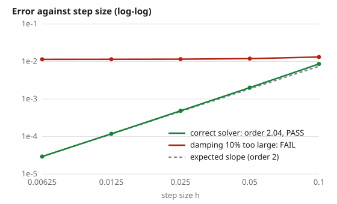

# Getting started

You need Python 3.10 or newer. physverify depends only on NumPy (SymPy is optional, for deriving source terms).

```bash
pip install physverify
```

## 1. Run the demo

```bash
physverify demo
```

It runs the checks on a correct midpoint solver for a damped oscillator (all pass), then on a copy with the damping 10% too large (all fail). No files are needed.



To see the same example as files you can edit, clone the repository:

```bash
git clone https://github.com/rcgiri-physics/physverify.git
cd physverify
physverify run examples/verify_damped_oscillator.py
```

```text
mms        PASS         midpoint damped oscillator: observed order 2.04 (expected 2)
reference  PASS         midpoint damped oscillator: observed order 2.01 (expected 2)
mms        PASS         midpoint damped oscillator (whole trajectory): observed order 2.02 (expected 2)
patch      EXACT        midpoint damped oscillator: reproduced to round-off (largest error 2.7e-15), as designed
4 of 4 checks passed
```

Now open `examples/damped_oscillator.py`, change the damping by 10%, and run the command again: the checks fail, because the code no longer solves the equation the spec describes.

## 2. Read the spec

A *spec* is a Python file that defines `checks()`. It tells physverify two things:

1. **The equations your code is meant to solve**, written again from the physics, independently of your code. If you copy them from the code, a mistake in the code is copied too and the checks pass.
2. **How to run your code**: a function `integrate(source, y0, t_end, n_steps)` that runs it for `n_steps` fixed steps and adds `source(t)` to the right-hand side.

```python
--8<-- "examples/verify_damped_oscillator.py"
```

`ode_checks` bundles the standard checks for an ODE solver: a manufactured solution, a reference solution, the whole-trajectory error and the exact patch test.

## 3. Start a spec for your own solver

```bash
physverify init verify_solver.py --solver mysolver --order 4
```

This writes a spec for `mysolver.integrate` with the step counts filled in. Fill in the two places marked TODO (the equations and a starting state); until then every check reports ERROR.

## 4. Other ways to run it

```bash
physverify run my_spec.py --html report.html   # a web page with convergence plots
physverify run my_spec.py --json -             # machine-readable output
physverify run my_spec.py --budget 60          # at most about a minute per check
pytest my_spec.py                              # each check becomes a pytest test
```

## What if my code has no source-term hook?

Write a small wrapper in the spec that adds one; [Recipes](recipes.md#a-code-with-no-source-term-hook) shows how. If even that is hard, start with the checks that need no hook: [reference solutions](checks/reference.md), [conserved quantities](checks/conservation.md), [exact references](checks/exact-references.md) and the [Runge-Kutta table check](checks/runge-kutta.md).

## If a check fails

See [Troubleshooting](troubleshooting.md): it may be the spec or the adapter rather than your code.
