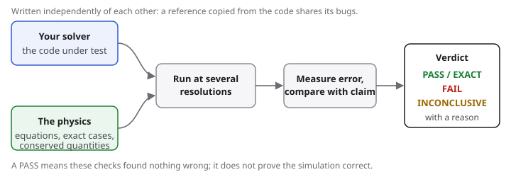

# How it works

physverify does not need to know the right answer for your simulation. It uses a few standard ideas from numerical analysis, each of which turns "is this correct?" into a question with a definite answer.

## 1. Make up an answer, then check the code finds it

Pick a smooth function u(t), say u(t) = sin(1.3 t). It is not a solution of your equation y' = f(t, y), but it becomes one if you add the "missing push"

    s(t) = u'(t) - f(t, u(t)).

Run your code on y' = f(t, y) + s(t), and it should reproduce u(t). This is the **method of manufactured solutions** (MMS). physverify computes s(t) for you from a reference f that you write again from the physics.

## 2. Check that the error shrinks at the right speed

A method of order p has error roughly C h^p for step size h. Halve h, and the error of a 4th-order method should fall by 2^4 = 16. If it only falls by 2, something is wrong, even if the error looked small. physverify runs your code at several step sizes, fits the slope on a log-log plot (the **observed order**) and compares it with the order the method claims.

This is far more sensitive than comparing with one answer: a wrong sign in a small term may change the answer by 0.1%, but it changes the order from 4 to 1.

## 3. Check what must not change

Energy, momentum, mass and heat with insulated walls are conserved by the physics. A code may let them drift, but only as fast as its order allows. And some budgets are kept *exactly* by a conservative scheme on every grid; any mismatch there is a bug.

## 4. Check special cases you know

A projectile without drag, a heat-equation sine mode, a Kepler orbit, the infinite square well: closed-form answers exist, and physverify ships a collection of them (`physverify references`).

## 5. Exact "patch" tests

Some solutions are reproduced *exactly* by a correct scheme, to computer precision, for every step size. For an explicit Runge-Kutta method, a solution linear in t is one. Then the expected error is zero, not small, so bugs that are as small as the method's own error still show up.

## 6. Algebra on the method itself

Whether a Runge-Kutta table really has order 4 can be settled exactly from its coefficients, with no test problem at all (Butcher's order conditions). The same is true of its stability properties.

## Reading the results

| Status | Meaning |
|---|---|
| PASS | The check found what it expected. |
| EXACT | The error was at round-off level everywhere: the code reproduced the solution exactly. |
| FAIL | The check found something wrong; the message says what. |
| INCONCLUSIVE | The errors were too small or too noisy to measure an order; the message says why and what to try. |
| ERROR | The code under test raised an exception. |
| SKIP | Not run, because an optional package is missing. Neither a pass nor a failure. |

!!! warning "Passing is not proof"
    Passing every check does not prove a code correct, only that these tests found nothing wrong. A check can only be as good as the independent reference you give it.
