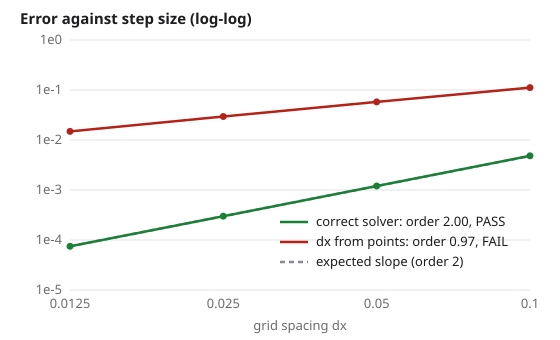

# Recipes

Short patterns for common situations. Each assumes `pip install physverify`.

!!! tip "Before trusting a PASS"
    Write the reference equations from the physics, not from the code; state units and signs; check initial and boundary conditions separately; test where bugs hide; add a second, independent check (a conserved quantity or a limit). See [What a PASS means](assumptions.md).

## Your own ODE solver

If your solver can run `n` fixed steps and accept an extra term on the right-hand side, `ode_checks` gives the standard set. [Getting started](getting-started.md#2-read-the-spec) shows a complete spec; `physverify init` writes one for you:

```bash
physverify init verify_solver.py --solver mysolver --function integrate --dim 2 --order 4
```

## A code with no source-term hook

Wrap it. If the code takes a right-hand-side function, add the source inside a new one:

```python
import numpy as np
from mycode import solve          # solve(rhs, y0, t_end, n_steps) -> final state

def integrate(source, y0, t_end, n):
    def rhs(t, y):
        return my_rhs(t, y) + source(t)
    return solve(rhs, y0, t_end, n)
```

If the right-hand side is hard-wired, the code can usually still take a forcing through a parameter (an external field, a heat source). When it cannot, use the checks that need no hook: [reference solutions](checks/reference.md), [conserved quantities](checks/conservation.md) and [exact references](checks/exact-references.md).

!!! note
    A wrapper can itself contain mistakes. Keep it short, and if a check fails, look at the wrapper first.

## A code that only writes files

Run it, read its output, and return the state:

```python
import subprocess, numpy as np

def integrate(source, y0, t_end, n):
    subprocess.run(["./mysim", f"--steps={n}", f"--tend={t_end}"], check=True)
    return np.loadtxt("final_state.txt")
```

Without a source hook, use a reference or exact solution with this `integrate`, and pass `source` through as unused.

## A script that asks for input

`loaders.run_script` runs a whole script with plotting switched off and answers its `input()` prompts in order:

```python
from physverify.loaders import run_script

g, printed = run_script("projectile.py", inputs=["45", "20"])   # angle, speed
print(g["range_m"], printed)
```

## A script that runs a simulation when imported

`loaders.load_definitions_from_path("sim.py")` loads only its functions and classes, without running the top-level simulation. `loaders.stub_modules({...})` stands in for imports that the tested part does not need (a GUI, a web framework).

## A Runge-Kutta library in continuous integration

Check every table, with each property the method's name claims. A test file in the library's own test suite:

```python
import pytest
from physverify.butcher import check_tableau
from mylib import SCHEMES          # name -> object with A, b, c, order, ...

@pytest.mark.parametrize("name", sorted(SCHEMES))
def test_tableau(name):
    s = SCHEMES[name]
    r = check_tableau(s.A, s.b, s.c, claimed=s.order,
                      claimed_linear=getattr(s, "order_linear", None),
                      l_stable=getattr(s, "l_stable", None))
    assert r.ok, r.message
```

Add `physverify>=0.4` to the test dependencies only; the library itself does not need it.

## A 1D heat (diffusion) code

Make up a smooth u(x, t) that meets the boundary conditions, add the source s = u_t - u_xx that makes it a solution, and measure the error at several grid sizes. An explicit scheme with dt proportional to dx² should be second order in dx. Here the bug is a grid spacing taken from the number of points instead of the number of intervals; the solver still runs and looks smooth.

```python
--8<-- "docs/examples/heat_order.py"
```

Output:

```text
--8<-- "docs/examples/output/heat_order.txt"
```



If the code has no source-term hook, see [A code with no source-term hook](#a-code-with-no-source-term-hook). Check the heat budget too (insulated walls must not leak): [Conserved quantities and budgets](checks/conservation.md).

## An inference code (fits, posteriors, error bars)

An interval with a stated level should contain the truth that often. Simulate data from a known truth many times, ask the code for its interval each time, and count. Draw the truth from the prior the analysis assumes; for a frequentist interval a fixed truth works too. The second fit below assumes unit noise when the noise is 0.3, so its intervals are far too wide; the coverage is 100% instead of 68%.

```python
--8<-- "docs/examples/inference_coverage.py"
```

Output:

```text
--8<-- "docs/examples/output/inference_coverage.txt"
```

Coverage that is too high is a bug as well: the error bars overstate the uncertainty. A PASS says only that the intervals have the right size on average for this model; see [Statistics and Monte Carlo](checks/statistics.md).

## A Monte Carlo sampler

Compare a sampled average with a value known exactly, using independent chains: the spread of the chain means is an honest standard error even when each chain is autocorrelated. The buggy sampler below uses a proposal that is not symmetric and leaves out the Hastings factor, so it samples the wrong distribution while looking well mixed.

```python
--8<-- "docs/examples/mc_sampler.py"
```

Output:

```text
--8<-- "docs/examples/output/mc_sampler.txt"
```

For 2D Ising samplers there are ready-made checks against Onsager's and Kaufman's exact results: [Ising checks](ising.md).

## A slow code

Give each check a time budget so one slow check does not use up the whole run:

```bash
physverify run verify_slow.py --budget 120
```

Order studies then stop adding finer resolutions when the next would not fit, fit what they have and say so. See [Command line](running/cli.md#time-budget).

## Somebody else's code

Run untrusted code in the locked-down container in [`sandbox/`](https://github.com/rcgiri-physics/physverify/blob/main/sandbox/README.md): no network, read-only source, limited memory and time. Start with a smoke run, which finds scripts that do not parse, crash, wait for input or produce NaNs:

```bash
physverify smoke path/to/repo
```

`smoke` runs the code, so use it on code you trust or inside the sandbox.
