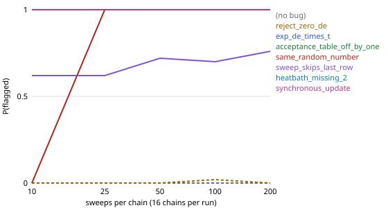

# Ising checks: calibration and power

Generated by `python -m physverify.stochastic.calibrate results/ising_calibration.md`.

## Calibration on the bug-free Metropolis sampler

Each replicate is 32 independent chains of 200 sweeps on L = 4 (after the sampler's burn-in of 100),
analysed exactly as the check analyses its chains. 95% Wilson intervals in brackets.

| Test | T | Comparisons | Rejected at 0.05 | Rejected at 0.01 | Check FAIL rate at alpha = 0.05 |
|---|---|---|---|---|---|
| exact_distribution | 2.5 | 18000 | 0.0444 [0.0415, 0.0476] | 0.0089 [0.0076, 0.0104] | 32 of 1000 = 0.032 [0.023, 0.045] |
| moments | 2.269 | 4000 | 0.0595 [0.0526, 0.0673] | 0.0095 [0.0069, 0.0130] | 18 of 1000 = 0.018 [0.011, 0.028] |
| moments | 1.8 | 4000 | 0.0550 [0.0484, 0.0625] | 0.0115 [0.0086, 0.0153] | 23 of 1000 = 0.023 [0.015, 0.034] |

Reading: per-comparison rejection rates near the nominal level mean the error bars are right; the check-level
FAIL rate must stay at or below its alpha (Bonferroni makes it conservative). The checks themselves use
alpha = 0.001, which cannot be measured directly with 1000 replicates; the 0.05 runs test the same machinery.

## Power: probability that `exact_distribution` flags a bug

50 replicate runs per cell, each 16 chains on L = 4 at T = 2.5, alpha = 0.001.

| Bug | 10 sweeps | 25 sweeps | 50 sweeps | 100 sweeps | 200 sweeps |
|---|---|---|---|---|---|
| (no bug) | 0.00 | 0.00 | 0.00 | 0.00 | 0.00 |
| reject_zero_de | 0.00 | 0.00 | 0.00 | 0.02 | 0.00 |
| exp_de_times_t | 1.00 | 1.00 | 1.00 | 1.00 | 1.00 |
| acceptance_table_off_by_one | 1.00 | 1.00 | 1.00 | 1.00 | 1.00 |
| same_random_number | 0.00 | 1.00 | 1.00 | 1.00 | 1.00 |
| sweep_skips_last_row | 0.62 | 0.62 | 0.72 | 0.70 | 0.76 |
| heatbath_missing_2 | 1.00 | 1.00 | 1.00 | 1.00 | 1.00 |
| synchronous_update | 1.00 | 1.00 | 1.00 | 1.00 | 1.00 |

`(no bug)` should stay near 0 (false alarms). `reject_zero_de` is the equivalent mutant: it keeps the
Boltzmann distribution, so a distribution check should not flag it at any run length.

